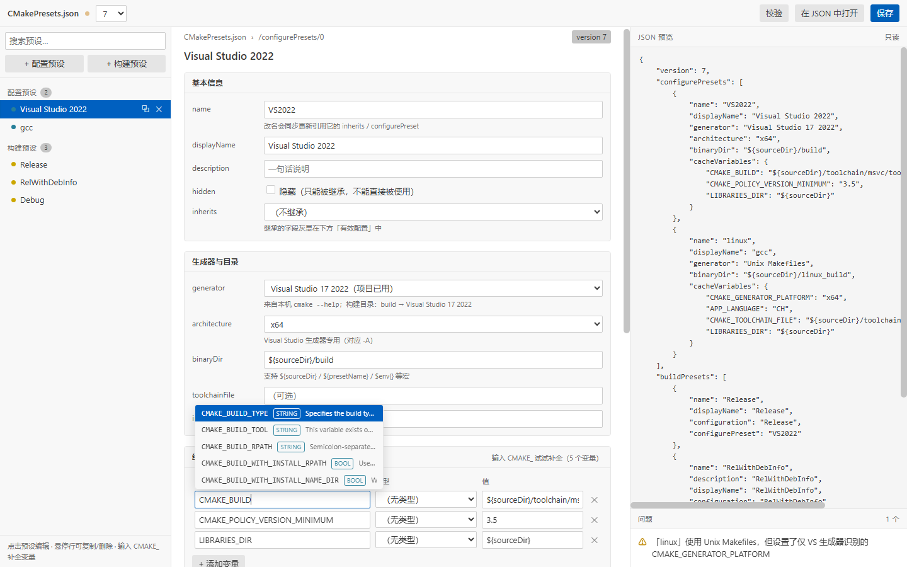
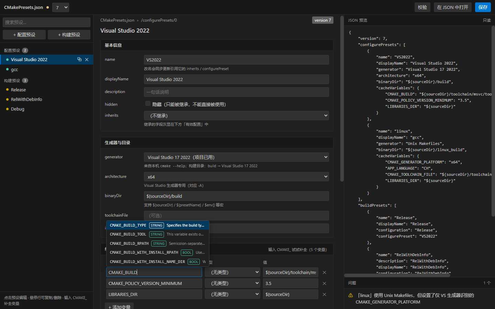

# cmake_preset_setting

CMake Presets 的可视化编辑：**方案 → 原型 → 数据工具 → VS Code 扩展**，四层都在这个仓库里。

| 目录 | 内容 |
|---|---|
| `demo/` | 原始示例 `CMakePresets.json`（version 7） |
| `docs/` | 需求与开发方案、可点击的交互原型 |
| `tools/var-catalog/` | 从本机 CMake 官方文档生成变量目录（839 条）+ 本地搜索服务 |
| `extension/` | VS Code 扩展（MVP，已可安装） |

## 快速开始

```powershell
# 1. 变量目录（可选，扩展已内置一份）
node tools/var-catalog/index.mjs build
node tools/var-catalog/index.mjs serve      # http://127.0.0.1:4848

# 2. 交互原型（不装 VS Code 也能看）
node tools/var-catalog/index.mjs build --prototype docs/prototype/variables.js
start docs\prototype\presets-editor.html

# 3. 扩展：构建 / 测试 / 打包安装
cd extension
npm.cmd install
npm.cmd test                                # 20 个用例
npm.cmd run package
code --install-extension build\cmake-presets-editor.vsix --force
```

装好后在 VS Code 里**重载窗口**，右键 `CMakePresets.json` → **打开方式…** → **CMake Presets 编辑器**。

## 它是怎么改文件的

不是整篇重写：webview 把「改了哪个字段」作为 JSON 路径 op 发回扩展，扩展用 `jsonc-parser` 只替换目标区间。
所以 Tab 缩进、键顺序、`vendor` 之类未知字段都保留，一次操作一步撤销，`git diff` 只有真正改动的那几行。

## 文档

- [需求与开发方案](docs/CMakePresets-可视化编辑器-开发方案.md)（含工时、风险、验收标准）
- [变量目录工具](tools/var-catalog/README.md)
- [扩展说明](extension/README.md)

## 截图

扩展界面颜色取自 VS Code 主题变量，浅色 / 深色自动适配：

| 浅色 | 深色 |
|---|---|
|  |  |
